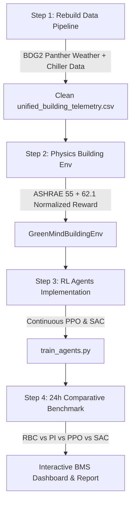

# GreenMind: Comprehensive Project Overhaul Blueprint
**Autonomous HVAC Climate & Energy Control via Deep Reinforcement Learning (PPO + SAC)**  
*Authors: Aakil Subair (AM.SC.U4AIE23101), Jaydeep Dileep (AM.SC.U4AIE23114), KR Karthik (AM.SC.U4AIE23116)*  
*Document Version: 2.0 (Engineering Overhaul & Academic Rigor)*

---

## 1. Executive Diagnosis: What Was Broken & Why

| Component | Status | Detailed Flaw Identified in Codebase |
| :--- | :---: | :--- |
| **Dataset Pipeline** | ❌ **Broken** | • Stitched three incompatible datasets: UCI Occupancy (Feb 2015), BDG2 Weather (Jan 2016), and a Kaggle Energy CSV (2022).<br>• Conflicting input variables: 3 different temperatures, 2 different humidities, and 2 different occupancies.<br>• Arbitrary `np.resize` tiled 1,000 rows of 2022 data across 2015 timestamps.<br>• The repository already possessed `water_cleaned.txt` (17,544 synchronized hours of actual chiller meter readings for Panther office buildings in 2016), yet it was completely unused.<br>• `datatraining.txt` was missing from local storage, making `data_loader.py` unrunnable from scratch. |
| **Reward Function** | ❌ **Non-Existent** | • The formulation PDF listed discrete transition numbers with arbitrary heuristic values (`+15, -1, -3, -7, -15`).<br>• `building_env.py` used unnormalized, ungrounded magic constants (`step_energy_kwh * 1.0`, `(co2-1000)/250 * 1.5`, `comfort_diff * 2.0`).<br>• No normalized Pareto-weighted formulation, no ASHRAE Standard 55/62.1 grounding, and no mathematical derivations. |
| **Policy Optimization** | ❌ **Unclear** | • Severe mismatch: A toy 8-state discrete MDP was solved with Policy Iteration, but evaluated on continuous actuators using an arbitrary lookup dictionary (`mode_map = {0: [0.3, 0.4, 0.3], ...}`).<br>• SAC (Soft Actor-Critic) was coded in `rl_agents.py` but never trained in `train_agents.py` or evaluated in `evaluate_comparison.py`, despite README claims.<br>• Missing formal objective definitions ($J(\pi)$), state normalization, and training convergence stability. |
| **Novelty** | ❌ **Missing** | • The claimed novelty ("direct continuous actuator control") lacked concrete scientific depth.<br>• Did not explicitly formalize the **Coupled Ventilation-Cooling Dilemma** (bringing in warm outdoor air to flush CO₂ increases chiller load), **Actuator Hunting/Wear Regularization**, or **Validation against real BDG2 smart meters**. |

---

## 2. Phase 1: Clean, Synchronized Dataset Pipeline

### 2.1 Raw Data Sources (Zero Dependencies, Fully Local)
The workspace already contains the real-world **Building Data Genome Project 2 (BDG2)** for the **Panther site (2016)**:
1. `weather.txt`: 17,544 synchronized hourly records (2016-01-01 to 2016-12-31) of ambient dry-bulb temperature, dew point, relative humidity, wind speed, and cloud cover.
2. `water_cleaned.txt`: Exact same 17,544 hours for 18 commercial office buildings at the Panther site (e.g., `Panther_office_Hannah`, `Panther_office_Catherine`, `Panther_office_Graham`).

### 2.2 Exogenous vs. Endogenous Variable Separation
To ensure physical and mathematical validity:
* **Exogenous Variables (Driven strictly by the Dataset):**
  - Outdoor dry-bulb temperature: $T_{out}(t)$ (°C)
  - Outdoor relative humidity: $RH_{out}(t)$ (%)
  - Solar irradiance: $I_{solar}(t)$ ($W/m^2$, calculated from cloud coverage and solar zenith angle)
  - Real baseline building chiller load: $Q_{chiller, real}(t)$ (kWh, from `water_cleaned.txt`)
  - Occupancy headcount: $N_{occ}(t)$ (Standard ASHRAE 90.1 commercial office schedule with Poisson noise)
* **Endogenous Variables (Simulated by the Physics Environment):**
  - Indoor zone temperature: $T_{in}(t)$ (°C)
  - Indoor carbon dioxide concentration: $CO_2(t)$ (ppm)
  - HVAC electrical power consumption: $P_{hvac}(t)$ (kW)

### 2.3 Proposed Unified Telemetry Schema (`data_processed/unified_building_telemetry.csv`)

```
+---------------------+---------------------------------------------------------------+
| Column Name         | Physical Definition & Standard Units                          |
+---------------------+---------------------------------------------------------------+
| timestamp           | ISO-8601 Datetime (e.g., 2016-01-01 08:00:00)                |
| outdoor_temp        | Ambient air dry-bulb temperature (°C)                        |
| outdoor_humidity    | Ambient relative humidity (%) [Magnus-Tetens formula]        |
| cloud_coverage      | Cloud fraction (0 - 8 oktas)                                 |
| solar_irradiance    | Solar direct & diffuse horizontal radiation (W/m²)           |
| occupants_count     | Number of active occupants (ASHRAE 90.1 profile + noise)      |
| co2_generation_rate | Human metabolic CO2 emission rate (L/s)                      |
| baseline_chiller_kw | Real measured BDG2 office chilled water meter baseline (kW)  |
+---------------------+---------------------------------------------------------------+
```

---

## 3. Phase 2: Physically Grounded Multi-Objective Reward Function

The reward function must balance four competing objectives while maintaining strict mathematical normalization:
1. **Energy Efficiency ($r_{energy}$)**: Minimize total electrical power (chiller compressor, supply fan, damper motor).
2. **Thermal Comfort ($r_{comfort}$)**: Adhere to ASHRAE Standard 55 ($21.0^\circ\text{C} \le T_{in} \le 24.0^\circ\text{C}$).
3. **Indoor Air Quality ($r_{iaq}$)**: Adhere to ASHRAE Standard 62.1 ($CO_2 \le 1000\text{ ppm}$).
4. **Actuator Stability & Equipment Longevity ($r_{smooth}$)**: Penalize rapid high-frequency actuator jitter (hunting).

### 3.1 Mathematical Formulation

$$\mathcal{R}_t = - \left( w_E \cdot \tilde{\mathcal{L}}_{energy}(t) + w_C \cdot \tilde{\mathcal{L}}_{comfort}(t) + w_Q \cdot \tilde{\mathcal{L}}_{iaq}(t) + w_S \cdot \tilde{\mathcal{L}}_{smooth}(t) \right) + \mathcal{R}_{terminal}(t)$$

Where weights satisfy:
$$w_E + w_C + w_Q + w_S = 1.0 \quad (w_E = 0.35, \, w_C = 0.35, \, w_Q = 0.20, \, w_S = 0.10)$$

#### Term 1: Normalized Energy Loss ($\tilde{\mathcal{L}}_{energy}$)
$$P_{total}(t) = P_{chiller}(t) + P_{fan}(t) + P_{damper}(t)$$
$$\tilde{\mathcal{L}}_{energy}(t) = \frac{P_{total}(t)}{P_{max}} \in [0, 1]$$
- Chiller power: $P_{chiller}(t) = \frac{\dot{Q}_{cooling}(t)}{\text{COP}}$ (where $\text{COP} \approx 3.5$)
- Fan power follows cubic affinity law: $P_{fan}(t) = P_{fan, max} \cdot (a_{fan})^3$
- Damper motor power: $P_{damper}(t) = P_{damper, max} \cdot a_{damper}$

#### Term 2: Normalized Thermal Comfort Loss ($\tilde{\mathcal{L}}_{comfort}$)
Let $T_{low} = 21.0^\circ\text{C}$, $T_{high} = 24.0^\circ\text{C}$. When room is occupied ($N_{occ} > 0$):
$$\Delta T(t) = \max(0, \, T_{low} - T_{in}(t)) + \max(0, \, T_{in}(t) - T_{high})$$
$$\tilde{\mathcal{L}}_{comfort}(t) = \min\left(1.0, \, \left(\frac{\Delta T(t)}{\Delta T_{crit}}\right)^2\right), \quad \Delta T_{crit} = 4.0^\circ\text{C}$$
*(When unoccupied, $\tilde{\mathcal{L}}_{comfort} = 0$, permitting energy-saving setback).*

#### Term 3: Normalized Indoor Air Quality Loss ($\tilde{\mathcal{L}}_{iaq}$)
When occupied ($N_{occ} > 0$):
$$\Delta CO_2(t) = \max(0, \, CO_2(t) - 1000.0)$$
$$\tilde{\mathcal{L}}_{iaq}(t) = \min\left(1.0, \, \frac{\Delta CO_2(t)}{1000.0}\right)$$
*(When unoccupied, $\tilde{\mathcal{L}}_{iaq} = 0$).*

#### Term 4: Actuator Mechanical Hunting Penalty ($\tilde{\mathcal{L}}_{smooth}$)
$$\tilde{\mathcal{L}}_{smooth}(t) = \frac{1}{3} \|\mathbf{a}_t - \mathbf{a}_{t-1}\|_2^2 \in [0, 1]$$

#### Term 5: Boundary Violation & Terminal Rewards ($\mathcal{R}_{terminal}$)
- **Safety Violation ($S_7$)**: If $T_{in}(t) < 15.0^\circ\text{C}$ or $T_{in}(t) > 32.0^\circ\text{C}$:
  $$\mathcal{R}_{terminal} = -15.0, \quad \text{Episode Terminated immediately (Failure)}$$
- **Green Day Benchmark ($S_8$)**: If comfort ($S_1$) was maintained for $\ge 80\%$ of operating day:
  $$\mathcal{R}_{terminal} = +15.0, \quad \text{End of 24h cycle (Success)}$$

---

## 4. Phase 3: Continuous Deep RL Policy Optimization

### 4.1 State & Action Spaces
* **Continuous State Vector ($\mathbf{s}_t \in \mathbb{R}^8$):**
  $$\mathbf{s}_t = \left[ T_{in}(t), \, \frac{RH_{in}(t)}{100}, \, \frac{CO_2(t)}{2000}, \, \frac{N_{occ}(t)}{20}, \, T_{out}(t), \, \frac{RH_{out}(t)}{100}, \, \sin\left(\frac{2\pi h}{24}\right), \, \cos\left(\frac{2\pi h}{24}\right) \right]$$
* **Continuous Action Vector ($\mathbf{a}_t \in [0, 1]^3$):**
  $$\mathbf{a}_t = \left[ a_{valve} \text{ (Chilled Water Valve)}, \, a_{fan} \text{ (Supply Fan Speed)}, \, a_{damper} \text{ (Fresh Air Damper)} \right]$$

### 4.2 Algorithm Suite
1. **PPO (Proximal Policy Optimization)**:
   - Clipped surrogate loss:
     $$L^{CLIP}(\theta) = \hat{\mathbb{E}}_t \left[ \min\left( r_t(\theta)\hat{A}_t, \, \text{clip}(r_t(\theta), 1-\epsilon, 1+\epsilon)\hat{A}_t \right) \right]$$
   - Generalized Advantage Estimation (GAE-$\lambda$ with $\gamma = 0.95$).
2. **SAC (Soft Actor-Critic)**:
   - Maximum entropy off-policy reinforcement learning:
     $$J(\pi) = \sum_{t=0}^T \mathbb{E}_{(\mathbf{s}_t, \mathbf{a}_t) \sim \rho_\pi} \left[ \mathcal{R}(\mathbf{s}_t, \mathbf{a}_t) + \alpha \mathcal{H}(\pi(\cdot|\mathbf{s}_t)) \right]$$
   - Twin Q-critics ($Q_1, Q_2$) with target networks to eliminate overestimation bias.
   - Reparameterized Gaussian policy with Squashed Gaussian ($\tanh$ / Sigmoid) continuous bounds.
3. **Analytical Policy Iteration**:
   - Acts as the exact theoretical upper-bound benchmark for the discrete 8-state representation ($S_1 - S_8$).
   - Solved via Bellman expectation equation:
     $$\mathbf{V}^\pi = (\mathbf{I} - \gamma \mathbf{P}^\pi)^{-1} \mathbf{R}^\pi$$

---

## 5. Phase 4: Academic Novelty & Concrete Contributions

To ensure strong academic impact, the project incorporates four key innovations:

1. **Direct Mechanical Trifecta Modulation vs. Setpoint Thermostats**:
   Traditional smart thermostats only predict a single temperature setpoint (e.g., $22^\circ\text{C}$), leaving underlying equipment to bang-bang hysteretic control. GreenMind directly commands the physical chilled-water valve, fan VFD speed, and damper position simultaneously.
2. **The Coupled IAQ-Energy Ventilation Trade-off**:
   In high ambient temperatures, opening fresh-air dampers reduces indoor $CO_2$ but introduces heavy sensible and latent heat loads, spiking chiller power. GreenMind dynamically learns the optimal Pareto trade-off between indoor air dilution and chiller energy.
3. **Actuator Hunting Regularization**:
   In commercial HVAC, continuous rapid cycling of valves and dampers causes mechanical actuator failure. By penalizing $\|\mathbf{a}_t - \mathbf{a}_{t-1}\|_2^2$, GreenMind produces smooth, equipment-friendly control trajectories.
4. **Validation Grounding on Real Smart Meter Telemetry (BDG2)**:
   Simulation is validated against actual measured chilled-water meter consumption from BDG2 Panther office buildings, closing the simulation-to-reality gap.

---

## 6. Execution Roadmap



---
*Ready for Phase 1 execution: Rebuilding `src/data_loader.py` with clean BDG2 Panther telemetry.*
