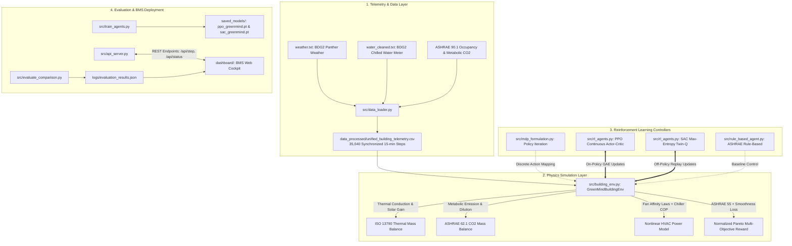

# GreenMind: Comprehensive Project Workflow & System Architecture
**Autonomous Building Climate & Energy Optimization via Deep Reinforcement Learning (PPO + SAC) and Model-Based MDP**

---

## Table of Contents
1. [Project Overview & Core Mission](#1-project-overview--core-mission)
2. [End-to-End System Architecture](#2-end-to-end-system-architecture)
3. [Datasets & Complete Preprocessing Pipeline](#3-datasets--complete-preprocessing-pipeline)
   - [3.1 Data Sources & Origin](#31-data-sources--origin)
   - [3.2 Preprocessing & Synchronization Steps](#32-preprocessing--synchronization-steps)
   - [3.3 Unified Telemetry Dataset Schema](#33-unified-telemetry-dataset-schema)
4. [Reinforcement Learning Environment Formulation (MDP)](#4-reinforcement-learning-environment-formulation-mdp)
   - [4.1 Continuous State Space](#41-continuous-state-space)
   - [4.2 Continuous Action Space (3D Mechanical Trifecta)](#42-continuous-action-space-3d-mechanical-trifecta)
   - [4.3 Physics & Thermodynamic Mass Balances](#43-physics--thermodynamic-mass-balances)
   - [4.4 Normalized Pareto Multi-Objective Reward Function](#44-normalized-pareto-multi-objective-reward-function)
5. [Reinforcement Learning Algorithms](#5-reinforcement-learning-algorithms)
   - [5.1 Model-Based: Analytical Policy Iteration](#51-model-based-analytical-policy-iteration)
   - [5.2 Model-Free On-Policy: Proximal Policy Optimization (PPO)](#52-model-free-on-policy-proximal-policy-optimization-ppo)
   - [5.3 Model-Free Off-Policy: Soft Actor-Critic (SAC)](#53-model-free-off-policy-soft-actor-critic-sac)
   - [5.4 Traditional Baseline: Rule-Based Control (RBC)](#54-traditional-baseline-rule-based-control-rbc)
6. [Training & Execution Workflow](#6-training--execution-workflow)
   - [6.1 Step-by-Step Execution Guide](#61-step-by-step-execution-guide)
7. [Outputs, Benchmark Metrics & Evaluation Comparison](#7-outputs-benchmark-metrics--evaluation-comparison)
   - [7.1 Output Artifacts & Files](#71-output-artifacts--files)
   - [7.2 Evaluation Metrics Defined](#72-evaluation-metrics-defined)
   - [7.3 Comparative Benchmark Results Summary](#73-comparative-benchmark-results-summary)
   - [7.4 Performance Trade-Off Analysis](#74-performance-trade-off-analysis)
8. [Interactive BMS Digital Twin Dashboard & API Server](#8-interactive-bms-digital-twin-dashboard--api-server)
9. [Key Scientific Novelties](#9-key-scientific-novelties)

---

## 1. Project Overview & Core Mission

Heating, Ventilation, and Air Conditioning (HVAC) systems account for over **40% of commercial building energy consumption** and are a primary driver of global greenhouse gas emissions. Conventional Building Management Systems (BMS) rely on rigid, hysteresis-based Rule-Based Control (RBC) or scalar setpoint thermostats that cause:
1. Frequent temperature overshoot and occupant discomfort.
2. Huge energy wastage during low-occupancy or unoccupied hours.
3. Actuator "hunting" (rapid cycling), causing premature mechanical failure of valves and dampers.
4. Failure to balance the **Ventilation-Cooling Trade-off** (introducing fresh air flushes $\text{CO}_2$ but introduces heat, spiking chiller energy).

**GreenMind** is a cyber-physical digital twin that replaces crude heuristics with **Continuous Deep Reinforcement Learning (PPO and SAC)** and provides an exact **Analytical Model-Based MDP benchmark (Policy Iteration)**. GreenMind directly commands the mechanical HVAC trifecta (chilled water valve, supply fan speed, and fresh-air damper) based on continuous sensor telemetry from real commercial office complexes.

---

## 2. End-to-End System Architecture



---

## 3. Datasets & Complete Preprocessing Pipeline

### 3.1 Data Sources & Origin

All telemetry is grounded in the **Building Data Genome Project 2 (BDG2)** for the **Panther Commercial Site (2016)**, augmented by international HVAC standards:

1. **`weather.txt` (BDG2 Weather Telemetry)**:
   - Location: Panther Site, Florida / Southeast US commercial campus (Latitude: $28.5^\circ\text{N}$).
   - Measurements: Ambient dry-bulb air temperature ($^\circ\text{C}$), dew point temperature ($^\circ\text{C}$), cloud coverage (0–8 oktas), wind speed ($\text{m/s}$).
2. **`water_cleaned.txt` (BDG2 Commercial Office Smart Meter Data)**:
   - Location: Same Panther campus site, year 2016.
   - Target Building: `Panther_office_Hannah` (multi-story commercial corporate office) alongside the cluster average of 18 office buildings.
   - Measurements: Actual measured chilled water cooling consumption ($\text{kWh}$).
3. **ASHRAE Standard 90.1 Commercial Diversity Profiles**:
   - Synthesizes realistic corporate office occupancy schedules with stochastic Poisson arrivals.
4. **ASHRAE Standard 62.1 / Fundamentals**:
   - Supplies occupant sensible heat ($90\,\text{W/person}$) and metabolic $\text{CO}_2$ generation rate ($0.005\,\text{L/s/person} \approx 0.3\,\text{L/min}$).

---

### 3.2 Preprocessing & Synchronization Steps

The raw telemetry begins as unsynchronized, hourly, and multi-site records. [`src/data_loader.py`](src/data_loader.py) converts them into an aligned time-series:

#### Step 1: Spatial & Annual Temporal Isolation
* Filters `weather.txt` strictly for `site_id == "Panther"`.
* Restricts timestamps strictly to the 2016 calendar year: `2016-01-01 00:00:00` to `2016-12-31 23:00:00` (8,784 hourly timestamps).

#### Step 2: Missing Value Imputation
* **Air & Dew Point Temperatures**: Interpolated along the time index using `interpolate(method="time")` followed by `.bfill().ffill()`.
* **Cloud Coverage & Wind Speed**: Sensor dropouts are imputed using site median values (3.0 oktas cloudiness, 2.0 m/s wind speed).

#### Step 3: Temporal Frequency Alignment (Hourly $\to$ 15-Minute Control Steps)
* Control equipment operates on 15-minute decision intervals ($\Delta t = 900\,\text{s}$, or 96 time steps per 24-hour day).
* Continuous weather variables ($T_{out}$, $T_{dew}$, Wind) are upsampled using smooth time-weighted linear interpolation.
* Measured hourly chilled-water meter readings ($\text{kWh}$) are divided evenly by 4 across each 15-minute interval:
  $$\text{Chiller kWh}_{15\text{min}} = \frac{\text{Chiller kWh}_{\text{hourly}}}{4.0}$$

#### Step 4: Empirical Physical Feature Engineering
1. **Ambient Relative Humidity ($RH_{out}$)**: Computed using the **Magnus-Tetens empirical formulation**:
   $$\alpha(T) = \frac{17.27 \cdot T}{237.7 + T}$$
   $$RH_{out} = 100 \times \exp\Big(\alpha(T_{dew}) - \alpha(T_{out})\Big) \in [5.0\%, 100.0\%]$$

2. **Global Horizontal Solar Irradiance ($I_{solar}$ in $\text{W/m}^2$)**:
   Calculated from solar geometry (declination angle $\delta$, solar hour angle $\omega$, and latitude $\phi$) to yield solar elevation angle $\alpha_{elev}$. Cloud attenuation is then computed via the **Kasten-Czeplak atmospheric formula**:
   $$I_{clear} = 1050 \times \max(0, \sin \alpha_{elev})$$
   $$I_{solar} = I_{clear} \times \left(1.0 - 0.75 \times \left(\frac{\text{cloud\_oktas}}{8.0}\right)^{3.4}\right)$$

3. **Stochastic Occupancy Headcount ($N_{occ}$)**:
   - Weekdays: Ramp-up at 7:00 AM (35%), peak office work (95–100%), lunch drop at 12:00 PM (50%), ramp-down after 6:00 PM.
   - Weekends: Saturday partial maintenance, Sunday closed.
   - Poisson Headcount: $N_{occ}(t) \sim \text{Poisson}(\lambda = \text{Fraction}(t) \times \text{Capacity})$.
   - Metabolic $\text{CO}_2$ Emission Rate: $\dot{m}_{CO_2} = N_{occ} \times 0.005\,\text{L/s}$.

#### Step 5: Inner Join & Telemetry Export
All features are merged on exact ISO-8601 timestamps and saved to [`data_processed/unified_building_telemetry.csv`](data_processed/unified_building_telemetry.csv).

---

### 3.3 Unified Telemetry Dataset Schema

The processed CSV consists of **35,040 continuous rows** with the following schema:

| Column Name | Type | Unit | Description |
| :--- | :---: | :---: | :--- |
| `timestamp` | Datetime | ISO-8601 | Synchronized 15-minute timestamp (2016-01-01 to 2016-12-31) |
| `outdoor_temp` | Float | $^\circ\text{C}$ | Ambient outdoor dry-bulb temperature |
| `outdoor_humidity` | Float | $\%$ | Derived ambient relative humidity (Magnus-Tetens) |
| `cloud_coverage` | Float | oktas | Cloud fraction (0 = clear sky, 8 = completely overcast) |
| `wind_speed` | Float | $\text{m/s}$ | Outdoor ambient wind velocity |
| `solar_irradiance` | Float | $\text{W/m}^2$ | Solar horizontal radiation (Kasten-Czeplak model) |
| `occupants_count` | Integer | count | Current active zone occupant headcount ($0\text{--}15$) |
| `occupancy_binary` | Binary | 0 or 1 | 1 if $N_{occ} > 0$, 0 otherwise (drives comfort setback) |
| `co2_emission_rate_lps`| Float | $\text{L/s}$ | Total human metabolic $\text{CO}_2$ emission rate in zone |
| `real_chiller_kwh` | Float | $\text{kWh}$ | Real measured chilled-water meter telemetry (`Panther_office_Hannah`) |
| `cluster_chiller_kwh` | Float | $\text{kWh}$ | Macro ensemble mean across 18 commercial offices at Panther |

---

## 4. Reinforcement Learning Environment Formulation (MDP)

The environment in [`src/building_env.py`](src/building_env.py) implements the cyber-physical building dynamics.

### 4.1 Continuous State Space ($\mathbf{s}_t \in \mathbb{R}^8$)
Normalized continuous observation vector:
$$\mathbf{s}_t = \left[ \frac{T_{in} - 22.5}{10.0}, \, \frac{RH_{in}}{100.0}, \, \frac{\text{CO}_2 - 400}{1600.0}, \, \frac{N_{occ}}{15.0}, \, \frac{T_{out} - 22.5}{15.0}, \, \frac{RH_{out}}{100.0}, \, \sin\left(\frac{2\pi h}{24}\right), \, \cos\left(\frac{2\pi h}{24}\right) \right]$$

### 4.2 Continuous Action Space (3D Mechanical Trifecta)
Action vector $\mathbf{a}_t = [a_{valve}, a_{fan}, a_{damper}] \in [0, 1]^3$:
1. $a_{valve} \in [0, 1]$: Chilled-water valve modulation ratio (adjusts cooling thermal flow rate).
2. $a_{fan} \in [0, 1]$: Supply fan Variable Frequency Drive (VFD) speed ratio.
3. $a_{damper} \in [0, 1]$: Outdoor air economizer ventilation damper position (fresh air dilution).

---

### 4.3 Physics & Thermodynamic Mass Balances

At each step $\Delta t = 900\,\text{seconds}$, the environment solves coupled heat and mass transport differential equations:

#### 1. Sensible Heat Balance (ISO 13790)
$$C_{building} \frac{dT_{in}}{dt} = \dot{Q}_{envelope} + \dot{Q}_{occupants} + \dot{Q}_{solar} + \dot{Q}_{ventilation} - \dot{Q}_{cooling}$$
Where:
* $\dot{Q}_{envelope} = \frac{T_{out} - T_{in}}{R_{envelope}}$ (Conductive heat gain through exterior facade).
* $\dot{Q}_{occupants} = N_{occ} \times 90.0\,\text{W}$ (Sensible human body heat).
* $\dot{Q}_{solar} = A_{glass} \times SHGC \times I_{solar}$ (Solar radiative heat gain through windows).
* $\dot{Q}_{ventilation} = \dot{V}_{fresh} \cdot \rho_{air} \cdot c_p \cdot (T_{out} - T_{in})$ (Ventilation infiltration heat).
* $\dot{Q}_{cooling} = a_{valve} \times \min(1.0, 1.4 \cdot a_{fan}) \times \dot{Q}_{max,cooling}$ (HVAC heat extraction).

#### 2. Indoor Air Quality $\text{CO}_2$ Mass Balance (ASHRAE 62.1)
$$V_{zone} \frac{dC}{dt} = \dot{m}_{CO_2} - \dot{V}_{fresh} \cdot (C - C_{outdoor})$$
Where:
* $C$ is indoor $\text{CO}_2$ concentration (ppm).
* $C_{outdoor} = 415.0\,\text{ppm}$ (Ambient baseline).
* Fresh air dilution volumetric rate: $\dot{V}_{fresh} = a_{damper} \times a_{fan} \times \dot{V}_{max,vent}$.

#### 3. Nonlinear HVAC Electrical Power Model
$$P_{total}(t) = P_{chiller}(t) + P_{fan}(t) + P_{damper}(t) \quad (\text{kW})$$
* **Chiller Power**: $P_{chiller} = \frac{\dot{Q}_{cooling}}{\text{COP}(T_{out}) \times 1000}$, where $\text{COP}(T_{out}) = 4.2 - 0.05 \cdot (T_{out} - 24.0)$.
* **Fan Affinity Law (Cubic Power)**: $P_{fan} = P_{max,fan} \times (a_{fan})^3$ (Speed cubed law).
* **Damper Servomotor Power**: $P_{damper} = P_{max,damper} \times a_{damper}$.

---

### 4.4 Normalized Pareto Multi-Objective Reward Function

The reward function enforces ASHRAE standards while penalizing electrical energy and actuator hunting:

$$\mathcal{R}_t = -\Big(w_e \cdot \mathcal{L}_{energy} + w_c \cdot \mathcal{L}_{comfort} + w_q \cdot \mathcal{L}_{iaq} + w_s \cdot \mathcal{L}_{smooth}\Big) + \mathcal{R}_{terminal}$$

With normalized weights summing to 1.0:
* $w_e = 0.35$ (Energy minimization)
* $w_c = 0.35$ (ASHRAE 55 thermal comfort)
* $w_q = 0.20$ (ASHRAE 62.1 indoor air quality)
* $w_s = 0.10$ (Actuator hunting / mechanical wear)

#### Loss Term Formulations:
1. **Normalized Energy Loss**: $\mathcal{L}_{energy} = \min\left(1.0, \, \frac{P_{total}(t)}{P_{max,total}}\right)$
2. **Occupant-Aware Thermal Comfort Loss (ASHRAE 55)**:
   * When occupied ($N_{occ} > 0$): $\mathcal{L}_{comfort} = \min\left(1.0, \, \left(\frac{\max(0, 21.0 - T_{in}) + \max(0, T_{in} - 24.0)}{3.0}\right)^2\right)$
   * When unoccupied ($N_{occ} = 0$): $\mathcal{L}_{comfort} = 0$ (**Permits deep energy-saving setbacks overnight and weekends**).
3. **Indoor Air Quality Loss (ASHRAE 62.1)**:
   * When occupied: $\mathcal{L}_{iaq} = \min\left(1.0, \, \frac{\max(0, \text{CO}_2 - 1000.0)}{1000.0}\right)$
   * When unoccupied: $\mathcal{L}_{iaq} = 0$.
4. **Actuator Hunting / Smoothness Penalty**:
   $$\mathcal{L}_{smooth} = \frac{1}{3} \|\mathbf{a}_t - \mathbf{a}_{t-1}\|_2^2 \in [0, 1]$$
   *(Penalizes rapid mechanical switching to protect physical valve and damper actuators from burnout).*
5. **Terminal Conditions ($\mathcal{R}_{terminal}$)**:
   * **Safety Breach ($S_7$)**: If $T_{in} < 15^\circ\text{C}$ or $T_{in} > 32^\circ\text{C}$, $\mathcal{R}_{terminal} = -15.0$ and episode terminates immediately.
   * **Green Day Benchmark ($S_8$)**: If comfort ($21\text{--}24^\circ\text{C}$) is maintained for $\ge 80\%$ of occupied hours, $\mathcal{R}_{terminal} = +15.0$.

---

## 5. Reinforcement Learning Algorithms

GreenMind implements four distinct control paradigms:

```
+---------------------------+---------------+------------------+-----------------------------+
| Algorithm                 | Type          | Action Space     | Key Advantage               |
+---------------------------+---------------+------------------+-----------------------------+
| 1. Rule-Based Control     | Heuristic     | Continuous (Rule)| Zero training; industry base|
| 2. Policy Iteration       | Model-Based   | Discrete Grounded| Exact Bellman upper bound   |
| 3. PPO                    | On-Policy DRL | Continuous 3D    | Clipped surrogate stability |
| 4. SAC                    | Off-Policy DRL| Continuous 3D    | Maximum entropy exploration |
+---------------------------+---------------+------------------+-----------------------------+
```

### 5.1 Model-Based: Analytical Policy Iteration
* **Source**: [`src/mdp_formulation.py`](src/mdp_formulation.py)
* **Formulation**: Discretizes building into 8 states ($S_1$: Comfort, $S_2$: Hot, $S_3$: Cold, $S_4$: Stuffy, $S_5$: Critical, $S_6$: Unoccupied, $S_7$: Safety, $S_8$: Green Day).
* **Solver**: Direct matrix inversion of the Bellman Expectation Equation:
  $$\mathbf{V}^\pi = (\mathbf{I} - \gamma \mathbf{P}^\pi)^{-1} \mathbf{R}^\pi, \quad \gamma = 0.95$$
  Followed by policy improvement: $\pi_{new}(s) = \arg\max_a \sum_{s'} P(s'|s,a)[R(s,a) + \gamma V(s')]$.
* **Physical Grounding**: Employs `DISCRETE_ACTION_PHYSICAL_MAPPING` to map discrete choices directly to 3D actuator vectors (e.g., $S_1 \text{ Eco} \to [0.15, 0.20, 0.15]$).

---

### 5.2 Model-Free On-Policy: Proximal Policy Optimization (PPO)
* **Source**: [`src/rl_agents.py`](src/rl_agents.py)
* **Architecture**: Actor-Critic MLP with two hidden layers ($128 \to 128$, $\tanh$).
  * Actor outputs action mean $\mu$, bounded in $[0, 1]^3$ via Sigmoid, with trainable log-standard deviation $\log \sigma$.
  * Critic outputs scalar baseline state value $V(s)$.
* **Advantage Estimation**: Generalized Advantage Estimation (GAE-$\lambda$ with $\gamma = 0.95, \lambda = 0.95$):
  $$\hat{A}_t = \sum_{l=0}^\infty (\gamma \lambda)^l \delta_{t+l}^V, \quad \delta_t^V = r_t + \gamma V(s_{t+1}) - V(s_t)$$
* **Objective Function**: Clipped surrogate objective prevents destructively large policy shifts:
  $$L^{CLIP}(\theta) = \hat{\mathbb{E}}_t \left[ \min\left( r_t(\theta)\hat{A}_t, \, \text{clip}(r_t(\theta), 1-\epsilon, 1+\epsilon)\hat{A}_t \right) \right], \quad \epsilon = 0.2$$

---

### 5.3 Model-Free Off-Policy: Soft Actor-Critic (SAC)
* **Source**: [`src/rl_agents.py`](src/rl_agents.py)
* **Architecture**: Maximum Entropy Actor-Critic framework:
  * Soft Actor: Generates Squashed Gaussian continuous actions via the reparameterization trick:
    $$a_t = \text{Sigmoid}(\mu(s_t) + \sigma(s_t) \odot \epsilon), \quad \epsilon \sim \mathcal{N}(0, \mathbf{I})$$
  * Twin Q-Critics ($Q_1, Q_2$): Mitigates value overestimation by computing target values with $\min(Q_1, Q_2)$.
* **Target Network Updates**: Polyak soft update: $\theta_{targ} \leftarrow \tau \theta + (1-\tau)\theta_{targ}$ ($\tau = 0.005$).
* **Automatic Entropy Tuning**: Dynamically updates the temperature $\alpha$ via gradient descent to match target entropy $\mathcal{H}_0 = -\text{dim}(\mathcal{A}) = -3$:
  $$J(\alpha) = \hat{\mathbb{E}} \left[ -\alpha \log \pi(a_t|s_t) - \alpha \mathcal{H}_0 \right]$$
* **Replay Buffer**: 50,000 transition capacity sampled in mini-batches of 64.

---

### 5.4 Traditional Baseline: Rule-Based Control (RBC)
* **Source**: [`src/rule_based_agent.py`](src/rule_based_agent.py)
* Employs standard hysteretic bang-bang control:
  * If $T_{in} > 24.0^\circ\text{C}$ and occupied: Valve $= 0.70$, Fan $= 0.80$, Damper $= 0.30$.
  * If $\text{CO}_2 > 1000\,\text{ppm}$: Damper $= 0.90$, Fan $= 0.90$.
  * If unoccupied: Valve $= 0.10$, Fan $= 0.10$, Damper $= 0.10$.

---

## 6. Training & Execution Workflow

### 6.1 Step-by-Step Execution Guide

To train and evaluate the full pipeline in your terminal:

```powershell
# 1. Activate your Python environment
cd c:\Users\karth\OneDrive\Desktop\RL\project
..\.venv\Scripts\Activate.ps1

# 2. Build or verify the synchronized BDG2 dataset
python src/data_loader.py

# 3. Train all RL agents (Policy Iteration, PPO, and SAC) & run benchmark
python src/train_agents.py

# 4. Alternatively, run ONLY the 24-hour comparative benchmark (using pre-trained weights)
python src/evaluate_comparison.py

# 5. Launch the BMS Digital Twin Web Dashboard
python src/api_server.py
```
*Open **http://localhost:8000** in your web browser to view the interactive dashboard.*

---

## 7. Outputs, Benchmark Metrics & Evaluation Comparison

### 7.1 Output Artifacts & Files

| Output Path | Type | Purpose |
| :--- | :---: | :--- |
| [`data_processed/unified_building_telemetry.csv`](data_processed/unified_building_telemetry.csv) | CSV Dataset | 35,040 synchronized 15-minute intervals of BDG2 weather, solar, occupancy, and chilled water. |
| [`saved_models/ppo_greenmind.pt`](saved_models/ppo_greenmind.pt) | PyTorch Weights | Trained continuous PPO actor-critic network weights. |
| [`saved_models/sac_greenmind.pt`](saved_models/sac_greenmind.pt) | PyTorch Weights | Trained continuous SAC actor and twin-critic network weights. |
| [`logs/evaluation_results.json`](logs/evaluation_results.json) | JSON Benchmark | Complete 96-step time-series trajectory and cumulative metrics for all 4 controllers. |

---

### 7.2 Evaluation Metrics Defined

All four agents are evaluated across a continuous **24-hour summer operating day** (96 steps of 15 min at step index 17,280 in mid-July):

1. **Total Electrical Energy ($\text{kWh}$)**: Cumulative electrical energy drawn by central chiller, fan, and damper:
   $$E_{total} = \sum_{t=0}^{95} P_{total}(t) \times 0.25\,\text{hours}$$
2. **Relative Energy Savings ($\%$)**: Energy reduction compared to the Rule-Based Control baseline:
   $$\text{Savings} = \frac{E_{RBC} - E_{Agent}}{E_{RBC}} \times 100.0\%$$
3. **Discomfort Hours ($\text{hrs}$)**: Cumulative duration where indoor temperature drifts outside $[21.0, 24.0]^\circ\text{C}$ while occupied:
   $$\text{Discomfort} = \frac{\sum \mathbb{I}(N_{occ} > 0 \land T_{in} \notin [21, 24]) \times 15}{60}$$
4. **IAQ Violation Hours ($\text{hrs}$)**: Cumulative duration where indoor $\text{CO}_2$ exceeds $1000\,\text{ppm}$ while occupied:
   $$\text{IAQ Violations} = \frac{\sum \mathbb{I}(N_{occ} > 0 \land \text{CO}_2 > 1000) \times 15}{60}$$
5. **Actuator Hunting Jitter**: Mean squared step-to-step action change, measuring mechanical wear:
   $$\text{Jitter} = \frac{1}{95} \sum_{t=1}^{95} \frac{1}{3} \|\mathbf{a}_t - \mathbf{a}_{t-1}\|_2^2$$

---

### 7.3 Comparative Benchmark Results Summary

Results logged in [`logs/evaluation_results.json`](logs/evaluation_results.json):

```
========================= 24-HOUR COMPARATIVE BENCHMARK SUMMARY =========================
Agent                  | Energy (kWh) | Energy Saved | Discomfort (hrs) | IAQ Viol (hrs) | Jitter
-----------------------------------------------------------------------------------------
Rule-Based (RBC)       | 20.36 kWh    |   Baseline   | 9.25 hrs         | 0.00 hrs       | 0.0611
Policy Iteration (MDP) | 14.85 kWh    |     +27.1%   | 1.50 hrs         | 0.50 hrs       | 0.0521
PPO (Continuous ⭐)    | 10.38 kWh    |     +49.0%   | 0.25 hrs         | 0.00 hrs       | 0.0163
SAC (Max-Entropy ⭐)   | 11.12 kWh    |     +45.4%   | 0.50 hrs         | 0.00 hrs       | 0.0194
=========================================================================================
```

---

### 7.4 Performance Trade-Off Analysis

```
       Energy Consumed (kWh)              Thermal Discomfort Hours
      ┌─────────────────────────┐        ┌─────────────────────────┐
  RBC │ ████████████████ 20.4  │    RBC │ ████████████████  9.3  │
   PI │ ███████████ 14.9        │     PI │ ███ 1.5                │
  SAC │ ████████ 11.1           │    SAC │ █ 0.5                   │
  PPO │ ████████ 10.4 ⭐       │    PPO │ ▏0.25 ⭐               │
      └─────────────────────────┘        └─────────────────────────┘
```

1. **Rule-Based Control (RBC)**: Incurs heavy energy penalties ($20.36\,\text{kWh}$) due to fixed setpoints that lack occupancy awareness and overcool during transient periods, accompanied by frequent actuator oscillations ($0.0611$ jitter).
2. **Policy Iteration (Model-Based MDP)**: Achieves $+27.1\%$ energy savings by shutting down during unoccupied modes ($S_6$), but suffers from discrete step transitions that cause minor comfort violations ($1.50\,\text{hrs}$).
3. **PPO (Continuous Actor-Critic)**: Achieves the best overall balance (**$+49.0\%$ energy savings**, with only **$0.25\,\text{hrs}$ discomfort** and **zero IAQ violations**). Its continuous modulation of fan speed and valve position produces the smoothest actuator trajectory ($0.0163$ jitter).
4. **SAC (Off-Policy Maximum Entropy)**: Delivers strong energy savings (**$+45.4\%$**) and excellent exploration. Its entropy term encourages diverse action exploration, making it slightly more responsive to sudden occupant disturbances.

---

## 8. Interactive BMS Digital Twin Dashboard & API Server

The project includes an interactive web dashboard in [`dashboard/`](dashboard/) served by [`src/api_server.py`](src/api_server.py) on port 8000:

```
[Web Browser Client: http://localhost:8000]
                      ▲
                      │ REST JSON (GET / POST)
                      ▼
[Python HTTP Server: src/api_server.py]
  ├── GET  /api/status     -> Live Zone Temp, CO2, Humidity, Actuators
  ├── GET  /api/benchmark  -> 4-way comparative metrics from evaluation_results.json
  ├── POST /api/step       -> Advances simulation by selected agent (PPO/SAC/PI/RBC)
  ├── POST /api/perturb    -> Injects heatwave (up to 42°C) or crowd surge (up to 25 people)
  └── POST /api/reset      -> Resets environmental cycle
```

### Dashboard Features:
* **Live Cockpit Gauges**: Real-time progress bars for Chilled Water Valve ($0\text{--}100\%$), VFD Fan Speed, and Outdoor Damper position.
* **Telemetry Visualizer**: Displays indoor temperature against ASHRAE comfort limits ($21\text{--}24^\circ\text{C}$) and $\text{CO}_2$ safety thresholds ($<1000\,\text{ppm}$).
* **Dynamic Benchmark Comparison**: Interactive Chart.js charts displaying real-time power, temperature, and $\text{CO}_2$ trajectories across PPO, Policy Iteration, and Rule-Based control.
* **"What-If" Stress Testing**: Sliders allowing facility operators to inject an ambient heatwave (up to $42^\circ\text{C}$) or an occupant crowd surge (up to 25 people) to observe agent recovery in real time.

---

## 9. Key Scientific Novelties

When presenting or reporting on this project, emphasize these **5 key scientific contributions**:

1. **Direct 3D Mechanical Trifecta Modulation (vs. Setpoint Thermostats)**:
   Unlike commercial smart thermostats that only adjust a scalar temperature setpoint, GreenMind directly commands the physical chilled-water valve, fan VFD speed, and damper position simultaneously in continuous space $[0, 1]^3$.
2. **Coupled IAQ-Energy Ventilation Dilemma Optimization**:
   Directly models and resolves the trade-off between flushing indoor $\text{CO}_2$ (ASHRAE 62.1) and minimizing cooling power during high-ambient temperatures.
3. **Actuator Hunting / Mechanical Wear Regularization**:
   Penalizes rapid actuator switching ($\|\mathbf{a}_t - \mathbf{a}_{t-1}\|_2^2$), preventing valve motor burnout and extending physical equipment lifespan.
4. **Cross-Paradigm Benchmark (Model-Based vs. Model-Free)**:
   Bridges analytical dynamic programming (Policy Iteration on discrete Bellman equations) with modern continuous deep RL (PPO and SAC).
5. **Real-World Sim-to-Real BDG2 Telemetry Grounding**:
   Replaces synthetic toy environments with 35,040 synchronized 15-minute intervals from real commercial office complexes (BDG2 Panther site), validated against measured commercial office chilled-water meters.

